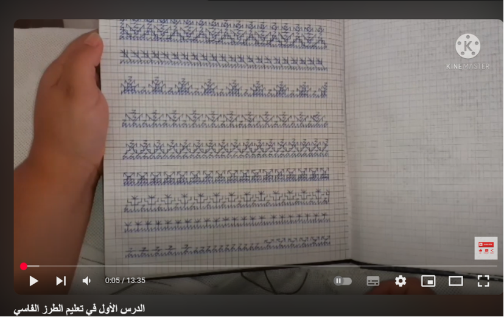
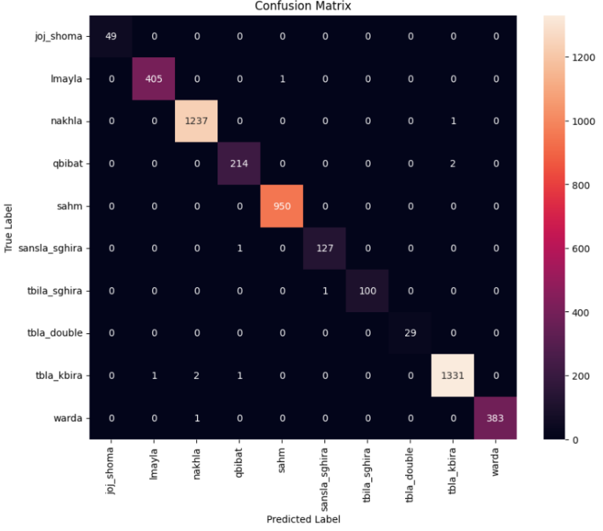
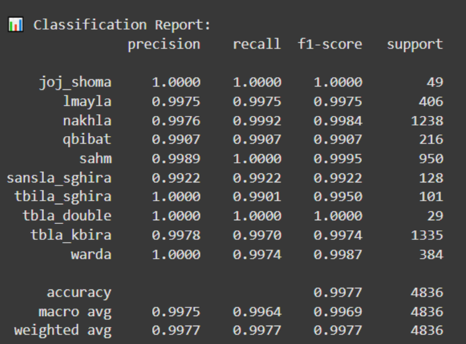
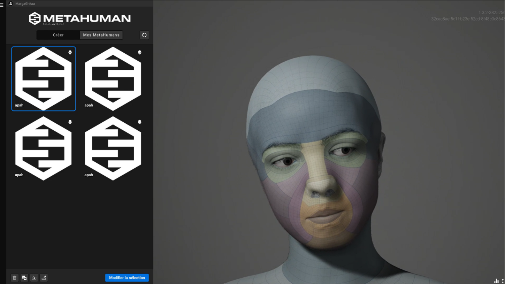
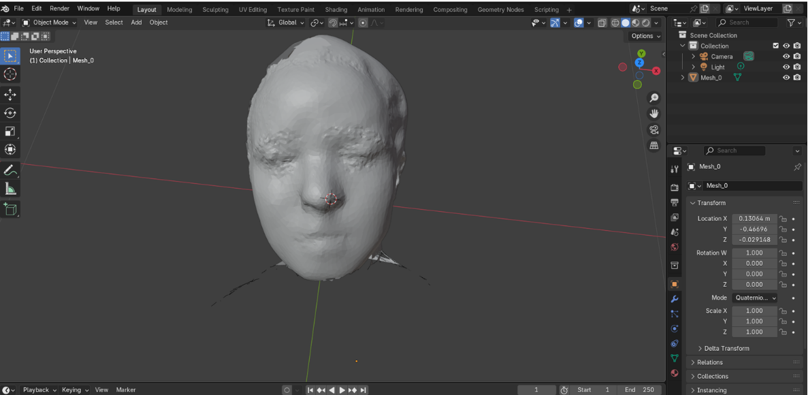
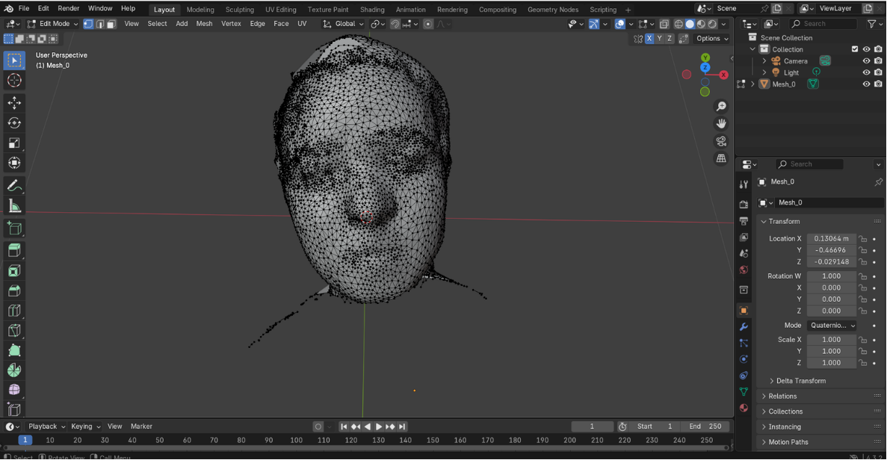

# M3lem — Digital Twin for Traditional Moroccan Embroidery Learning

The **M3lem project** is a **digital twin designed to teach traditional Moroccan embroidery**. Here is how we developed it.

To begin, we used **OpenMV and MediaPipe** to capture artisans’ hand movements. Each gesture was converted into a **sequence of frames**, with each frame representing the positions of the hand landmarks, particularly the wrist and fingers. We then **normalized** the data to standardize the wrist position and hand size, ensuring that the model would not be affected by differences in hand size or orientation.

To improve data quality and prevent overfitting, we applied **data augmentation** by generating slight variations of the sequences. We also ensured that the dataset had **balanced classes**. The classes were encoded as **one-hot vectors** for the model, while class labels were converted into integers using `LabelEncoder`. We then **split the dataset into training, validation, and test sets**, using stratified sampling to preserve the proportion of each class in each subset. To address class imbalance, we used **SMOTE** to synthetically oversample underrepresented classes and a **Random Undersampler** to reduce the size of overrepresented classes.

Users will wear a **VR headset** and use motion-tracking controllers or gloves to interact with the virtual embroidery environment. They can observe the artisan’s hand movements in 3D, zoom in on specific stitches, and practice the techniques themselves by mimicking the gestures in real time. The system will provide visual guides and immediate feedback on accuracy, helping users improve their skills step by step. This hands-on interaction makes learning more intuitive and engaging, allowing users to fully immerse themselves in the traditional craft from anywhere.

## Data Collection & Preprocessing 

We gathered embroidery videos mainly from YouTube, making sure to choose videos that clearly showed the hands, with good lighting and no visual obstructions. 
We used MediaPipe, a tool from Google, to automatically detect and extract 21 key points on each hand, like finger joints and tips. This step replaced manual labeling and gave us precise hand movement data.

**Labels: (Fassi) patterns**

  

- We then selected sequences of 35 consecutive frames, which represent about two seconds of continuous motion. This helped us capture the full gesture rather than just a single hand position. 

- We also applied normalization. This means we adjusted the keypoint data to make it consistent, no matter the hand size or camera angle. We centered the data around the wrist and scaled it based on hand size to make sure all gestures look similar to the model.

- To make our dataset even stronger, we used data augmentation. This means we artificially created more training examples by slightly changing the gesture sequences.

## Deep Learning Model Architecture

For the model, we implemented the following **sequential deep learning architecture**:

- **`Conv1D(64)`** with ReLU activation and L2 regularization, followed by **Batch Normalization** and **Max Pooling** to extract local patterns and reduce the temporal dimensionality of the sequences.
- **`Conv1D(128)`** using the same techniques to capture more complex patterns.
- **`LSTM(128, return_sequences=True)`** to capture long-term temporal dependencies within the sequences.
- **`LSTM(64)`** to summarize the entire sequence into a more compact feature vector.
- A **`Dense(64, activation='relu')`** layer followed by **Batch Normalization**, and finally a **`Dense(num_classes, activation='softmax')`** output layer to generate probabilities for each type of embroidery stitch.

  
  

  The results might seem too perfect but this is because most patterns or designs actually use the same recurring finger movement

## Model Evaluation and Robustness Testing

After training, we evaluated the model on the test set and verified that all classes could be predicted (**unique predictions = 10/10**). We also tested its robustness by introducing **noise** and shuffling the order of frames, and compared its performance against baseline models such as **Random Forest** and **Logistic Regression**.
- Unique predictions shows it's differentiating between inputs. No overfitting
- A low change rate with noise indicates stability, suggesting the model learned meaningful patterns rather than brittle memorized examples
- Test set does not contain duplicates or near-copies of samples from the training set. This rules out leakage and supports valid generalization.
- None of the test samples have a very similar counterpart in the training set.

## 3D Integration and Digital Twin

Finally, we integrated the system into **Unreal Engine**, using a **MetaHuman character created in Blender**. The digital character reproduces the gestures recognized by the AI model, providing an immersive learning experience that allows users to learn traditional embroidery digitally.

  

- To create a realistic 3D model of the artisan’s face, high-resolution photos are captured from multiple angles using **Polycam’s Photo Mode**. Blurry or out-of-focus images are removed to ensure mesh quality. The dataset is processed using the “Full” mode (without object masking), generating a detailed 3D mesh. The resulting **GLB file**, containing both geometry and textures, is then imported into Blender for cleanup and rigging.
- Upon importing the GLB file into Blender, the 3D model undergoes manual refinement and topology optimization. The unnecessary components, such as the neck, body, and hair, are removed to isolate only the frontal part of the head, which is required for facial rigging in Metahuman Creator.

  
  

- To ensure mesh integrity, several cleanup operations are performed: Delete Loose Geometry, Degenerate Dissolve, then Merge by Distance. These steps prepare the mesh for rigging by ensuring that it is topologically clean and optimized.

- After downloading and enabling the MetaHuman plugin in **Unreal Engine 5.1**, tracking of active facial parameters should be activated to preserve the accuracy of the artisan’s facial features. This ensures that the imported 3D model remains true to the original expression and structure during animation and integration.

  ## Current Status & Limitations

M3alem was developed as a prototype exploring how gesture recognition, digital twins, and VR could support the transmission of traditional Moroccan embroidery skills.

While we developed the gesture recognition component and explored the integration architecture, the complete VR experience was not deployed within the project's timeframe. Access to suitable VR equipment and the planned sensor-equipped gloves was also limited by availability and cost.

### Technical Exploration: Model Integration

We explored two possible approaches for connecting the gesture recognition model to Unreal Engine and driving the MetaHuman avatar's animations through Control Rig.

**1. External inference API — Flask / FastAPI**

The model runs in a separate Python service, with Unreal Engine sending input data and receiving gesture predictions through a REST API.

- **Advantages:** Easier model updates, access to Python's computer vision and machine learning ecosystem, and separation between inference and the 3D application.
- **Trade-offs:** Communication latency, network configuration, and data serialization overhead.

**2. On-device inference — ONNX / TensorFlow Lite**

The model could be converted to a deployment-friendly format and integrated into the Unreal Engine application through a compatible runtime or plugin.

- **Advantages:** Potentially lower communication overhead, offline operation, and tighter integration between inference and animation.
- **Trade-offs:** Additional integration and optimization work, plugin compatibility, and hardware performance constraints, particularly for mobile VR.

These approaches were considered as alternative deployment architectures; the complete real-time VR integration was not finalized.

### Main Challenges

- **Hardware accessibility:** VR equipment and sensor-equipped gloves were costly or unavailable, limiting our ability to test the complete interaction experience.
- **Limited training data:** High-quality, diverse, and well-annotated videos of Moroccan embroidery gestures were difficult to obtain, making subtle hand movements and individual variations challenging to capture.
- **Generalization:** A model trained on a limited set of gestures may struggle with unseen movements, different users, and changing environmental conditions.
- **Computational constraints:** The combination of computer vision, gesture recognition, 3D assets, and Unreal Engine placed significant demands on available hardware. Performance, GPU memory, and storage limitations made development and testing more difficult.
- **Limited tactile feedback:** Video-based gesture recognition alone cannot reproduce the tactile and proprioceptive feedback that artisans rely on when performing delicate embroidery techniques.

### Future Work

The next steps would focus on turning the prototype into a functional, real-time training experience:

- **Real-time gesture recognition and VR feedback:** Connect live gesture predictions to the MetaHuman avatar and provide immediate visual guidance.
- **Sensor-equipped DIY gloves:** Integrate flex sensors and IMUs to capture finger bending and hand orientation more directly, complementing camera-based recognition.
- **Mobile VR deployment:** Optimize the inference pipeline and Unreal Engine scene for Android-based VR, then package and test the application on compatible hardware.
- **Improved datasets and generalization:** Collect more diverse demonstrations, evaluate performance across different users, and improve recognition of subtle gesture variations.
- **Extension to other crafts:** Explore applications in Moroccan weaving, carving, and other traditional artisanal practices.

The long-term goal is to provide an immersive, portable learning environment where learners can observe traditional techniques, practice gestures, and receive real-time feedback from a digital representation of the craft.

## Technologies Used

- **Gesture Capture:** OpenMV, MediaPipe
- **Data Processing:** Data Normalization, Data Augmentation, Label Encoding
- **Class Imbalance Handling:** SMOTE, Random Undersampling
- **Deep Learning:** CNN (Conv1D), LSTM, TensorFlow/Keras
- **Baseline Models:** Random Forest, Logistic Regression
- **3D Development:** Unreal Engine, MetaHuman, Blender

## Project Objective

Overall, this project combines **motion capture, deep learning for gesture recognition, and interactive 3D visualization**. It aims to train new artisans while preserving Morocco’s traditional embroidery craftsmanship.
